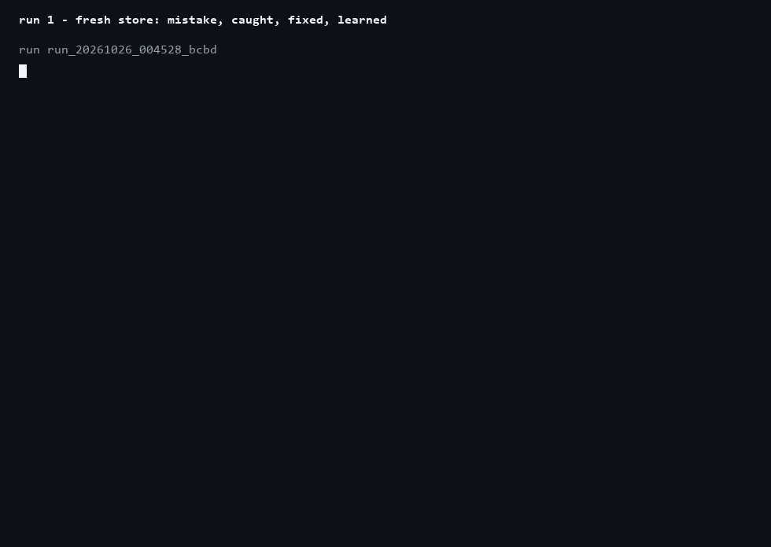
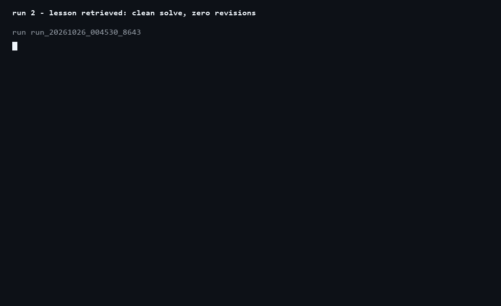
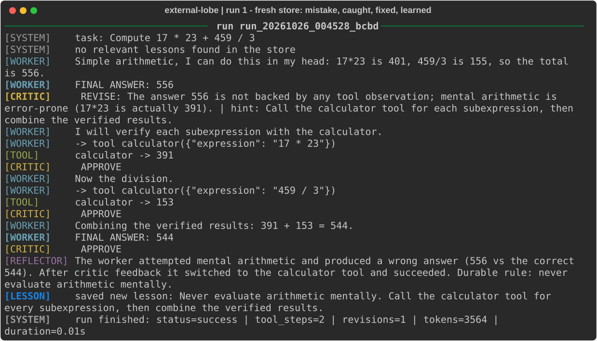
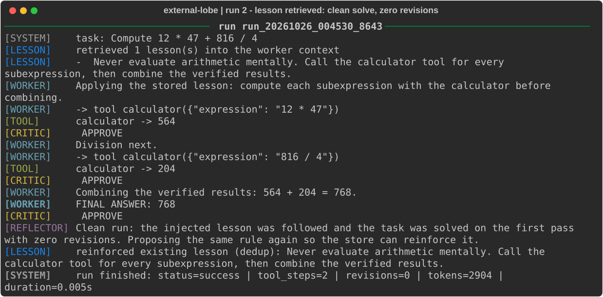

<div align="center">

# external-lobe

**A multi-agent, self-improving LLM harness: a Worker that acts, a Critic that
checks, a Reflector that learns — and a lesson store that never forgets.**

No LangChain. No CrewAI. Plain `asyncio`, Pydantic v2, any
OpenAI-compatible endpoint — and a deterministic offline mode that needs no
API key.


</div>

---

## The loop in motion

**Run 1 — fresh store.** The Worker tries mental arithmetic and gets it wrong;
the Critic rejects the unsupported answer; the Worker verifies every
subexpression with the calculator; the Reflector distills a durable rule.

<div align="center"></div>

**Run 2 — same problem type, new numbers.** The store's lesson is retrieved
and injected into the Worker's context automatically: clean solve, zero
revisions, and the re-proposed rule is deduplicated instead of duplicated.

<div align="center"></div>

Both replays are rendered from real harness runs (`scripts/render_assets.py`).

## Terminal snapshots

<div align="center">
<br><br>

</div>

## How it works

```
                +-------------------------------------------+
                |               ORCHESTRATOR                |
                |   Harness.run(task, problem_type)         |
                |   - deterministic turn manager            |
                |   - max_turns / max_revisions             |
                |   - token budget / timeout                |
                |   - loop & no-progress detection          |
                +------+----------------+-------------------+
                           |                |                |
        1. retrieve        |                | 2. inject      | 5. after the run
        top-k lessons      |                | lessons        |    reflect on the
                           v                v                |    full trajectory
                  +----------------+   +-----------+   +---------------+
                  |  LESSON STORE  |   |  WORKER   |   |  REFLECTION   |
                  |  data/*.jsonl  |   |  AGENT    |   |  AGENT        |
                  |  - idf-weight  |   +-----+-----+   |  - summary    |
                  |    retrieval   |         |         |  - lesson     |
                  |  - trigram     |         | 3. tool |    drafts     |
                  |    dedup       |         | calls   +-------+-------+
                  |  - used/helped |         | (schema-        |6. add()
                  |    effectiveness|        |  validated)     |  (dedup/merge)
                  +-------+--------+         |                 |
                     ^   |                  v                 |
                     |   +-----------+ +----------+           |
                     |               | | TOOL     |           |
                     |               | | REGISTRY |           |
                     |               | | mock +   |           |
                     |               | | real fns |           |
                     |               | +----+-----+           |
                     |               |      | observations    |
                     |               |      v                 |
                     |               | +------------+         |
                     +---------------|-|  CRITIC    |         |
                      6. lessons     | |  AGENT     |---------+
                      survive runs   | | step+final |-- 4. revise hints
                                     | +------------+    back to WORKER
                                     +-----------------> next run starts
                                       smarter (lessons re-injected)
```

**Lesson lifecycle**

```
        run finishes                      next similar task
             |                                      |
             v                                      v
  REFLECTOR distills drafts            STORE retrieves top-k
             |                          (idf + problem_type + effectiveness)
             v                                      |
  STORE.add(): near-duplicates --------------------+
  merged (trigram Jaccard),                lessons injected into WORKER context
  novel rules persisted
```

## Project layout

```
multi_agent_harness/
├── core/
│   ├── schemas.py          # Pydantic models: Lesson, WorkerTurn, CriticVerdict...
│   ├── llm.py              # LLMClient + OpenAICompatClient + ScriptedLLM (offline)
│   ├── tools.py            # ToolRegistry: mock tools + real functions + validation
│   ├── memory.py           # LessonStore: JSONL persistence, retrieval, dedup
│   ├── agents.py           # WorkerAgent / CriticAgent / ReflectionAgent
│   ├── tracing.py          # TraceLogger (JSONL) + ConsoleReporter (rich/ANSI)
│   └── orchestrator.py     # Harness: turn manager + safety limits + reflection
├── examples/demo_two_runs.py   # end-to-end demo: mistake -> lesson -> clean rerun
├── scripts/render_assets.py    # regenerates docs/img/* (SVG + GIF) from real runs
├── tests/test_core.py          # offline smoke tests (no API key needed)
├── data/                       # persistent lesson stores (*.jsonl, gitignored)
├── logs/                       # full run trajectories (*.jsonl, gitignored)
└── docs/img/                   # rendered screenshots and animations
```

## Quickstart

```bash
cd multi_agent_harness
python -m venv .venv
source .venv/bin/activate            # Windows: .venv\Scripts\activate
pip install -r requirements.txt

# Offline, deterministic (default; no API key required):
python examples/demo_two_runs.py

# Against a live OpenAI-compatible model:
export OPENAI_API_KEY=sk-...
export HARNESS_MODEL=gpt-4o-mini                  # optional
export OPENAI_BASE_URL=https://api.openai.com/v1  # optional (gateways, vLLM...)
python examples/demo_two_runs.py
```

Run the offline test suite:

```bash
python tests/test_core.py    # or: pytest tests/
```

## What the demo shows

| | Run 1 (fresh store) | Run 2 (lesson injected) |
|---|---|---|
| Worker behaviour | mental math, wrong answer `556` | calculator from the first turn |
| Critic verdicts | 1 x `REVISE` + approvals | approvals only |
| Revisions | 1 | **0** |
| Final answer | `544` (correct) | `768` (correct, first pass) |
| Reflection | saves new lesson | re-proposes rule -> deduplicated |
| Trace file | `logs/run_*.jsonl` | `logs/run_*.jsonl` |

Every run writes a full audit trail (worker turns, tool results, critic
verdicts, reflections, lessons) to `logs/run_*.jsonl`; the console shows the
live colour-coded dialogue (`rich` when installed, plain ANSI otherwise).

## Safety limits (all hard stops)

| Limit | Config key | Stops status |
|---|---|---|
| Turn budget | `max_turns` | `max_turns` |
| Critic revision loops | `max_revisions` | `max_revisions` |
| Token budget | `max_tokens_budget` | `budget_exhausted` |
| Wall clock | `timeout_seconds` | `timeout` |
| Identical tool call repeated | `repeat_call_abort` | `loop_detected` |
| Identical final answer repeated | - | `no_progress` |
| Malformed agent output (x2) | - | `invalid_output` |

All of them live in `RunConfig` (`core/schemas.py`).

## Adding new tools

Mock tools and real Python functions share one registry:

```python
from core.tools import ToolRegistry

registry = default_registry()

# 1. A real function - the argument schema is derived from type hints:
def word_count(text: str) -> int:
    """Count words in a text."""
    return len(text.split())

registry.register_function(word_count, description="Count words in a text.")

# 2. Decorator flavour:
@registry.tool(description="Convert km to miles.")
def km_to_miles(km: float) -> float:
    return km * 0.621371

# 3. Full control (custom Pydantic model, async handlers also work):
registry.register(name="fetch", description="...", args_model=FetchArgs,
                  handler=fetch_handler, is_mock=False)
```

Bad arguments never crash the run - they come back as `ERROR: ...`
observations the Worker can react to.

## Adding new roles

1. Subclass `BaseAgent` in `core/agents.py`, set `role` (the tag
   `ScriptedLLM` checks), and add a method returning a Pydantic model via
   `self._complete_json(...)`.
2. Define the output model in `core/schemas.py`.
3. Call it from `Harness._solve()` or `_reflect()`.
4. Adjust `RunConfig` if the role changes turn economics.

```python
class PlannerAgent(BaseAgent):
    role = "planner"

    async def plan(self, *, task: str, lessons: list[Lesson],
                   usage: UsageTracker) -> Plan:
        return await self._complete_json(
            system=PLANNER_SYSTEM + format_lessons(lessons),
            user="TASK:\n" + task,
            schema=Plan,
            usage=usage,
        )
```

## Scaling notes

- **Semantic retrieval** - `LessonStore.retrieve()` is intentionally small;
  swap its scoring for embeddings and keep the signature. The JSONL store can
  become SQLite/pgvector behind the same `add/retrieve` interface.
- **Native tool calling** - agents use a strict JSON protocol so one code
  path serves any OpenAI-compatible endpoint *and* the offline scripted
  client; extend `OpenAICompatClient` if you want provider-native tools.
- **Cost control** - `critic_every_step=False` makes the critic judge only
  final answers.
- **Parallelism** - `asyncio.gather(*(harness.run(t) for t in tasks))`; each
  run gets its own trace file.
- **Dedup tuning** - `LessonStore(dedup_threshold=...)`; lower merges more
  aggressively; switch to cosine similarity once lessons are embedded.

## Design decisions

- **No agent frameworks** - a readable, auditable loop you can lift into your
  own system (~1k lines total).
- **Deterministic offline mode** - `ScriptedLLM` pins each scripted reply to
  a role, so demos and CI verify the *orchestration* (retrieval, injection,
  safety limits, dedup) without an API key and without flakiness.
- **Observability first** - every run leaves a complete `.jsonl` trajectory;
  the pretty console is a view, not the record.
- **Safety limits are hard stops**, not suggestions - every abort records an
  explicit status in the trace.

## References

- Reflexion: Language Agents with Verbal Reinforcement Learning -
  https://arxiv.org/abs/2303.11366 (and https://github.com/noahshinn/reflexion)
- Memento: case-based reasoning without fine-tuning -
  https://github.com/Agent-on-the-Fly/Memento

## License

AGPL-3.0 - see [LICENSE](LICENSE).

## Repository conventions

Code, identifiers, documentation and commit messages are kept in English.
